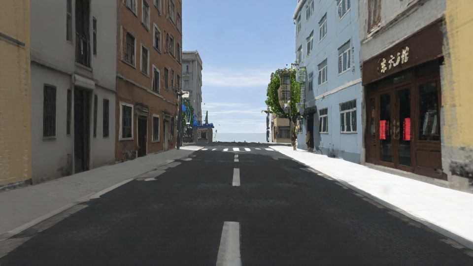

# 3dgen: generated street worlds for route training

**Walk from home to the clinic, the market or the senior centre through an endless street town that is generated as you walk, with a navigation panel that names a landmark at every turn and every frame repaired live by FastFix3D. The worlds are built for route practice by older adults with mild cognitive impairment (MCI) or early Alzheimer's disease, and need no hand-built scenes.**

- **Route training:** every walk starts at home, a residential compound with its name plate, and leads to one of four everyday destinations: a community health centre, a market, a senior centre or a post office. Every turn is at a crossing with a landmark.
- **Navigation panel:** turn-by-turn instructions in Chinese that name the landmark and the street (在便民服务亭路口右转，进入光明路: turn right at the convenience kiosk, into Guangming Road), a heading-up map with the route, the landmarks, home and the destination, remaining distance and walking time, and a warning when the walker leaves the route.
- **Generated while you walk:** 95.1 % of the non-sky picture is generated by Qwen-Image-2.1-Turbo the first time it comes into view: each building's facade (most with a shop and its Chinese sign), each street's asphalt, each block's paving, street trees, statues, benches, kiosks, poster columns and street clocks.
- **The same place every time:** the town is a pure function of a seed, and every generated image is cached by its key, so a street walked again looks exactly as before and a route can be practised day after day.
- **Real time:** 3DGS render and FastFix3D at 22–27 fps at 960×540 on one RTX PRO 6000.

*One frame of a walk through the generated town, repaired live by FastFix3D (960×540).*

*Street trees, statues, a bench, kiosks, community posters and a street clock, generated during walks.*

## Built for route practice

Older adults with MCI or early Alzheimer's disease often still recognise landmarks but cannot tie them to places and turns (deIpolyi et al. 2007), and practice in a detailed virtual town carries over to the real one (Wallet et al. 2011). The worlds follow from this.

- **A landmark at every decision point:** the brain stores what stands at a crossing without effort (Janzen & van Turennout 2004), and salient cues at decision points helped people with AD and MCI find their way (Davis et al. 2017). About half of the crossings carry a landmark, every turn of a route is at one, and the route planner prefers a different landmark for each turn.
- **Streets that can be told apart:** each street has its own name, each stretch between two crossings its own tree species, and most buildings a shop with its own Chinese sign.
- **Repeatable routes:** the routes are fixed by the seed, so the same route can be walked again with the same landmarks in the same places.
- **No invented content:** people with memory problems learn their own errors (Baddeley & Wilson 1994). The ray-traced town is the ground truth for every frame, FastFix3D keeps the 3D render and adds only a correction, and the ground truth view is available live for checking.
- **Smooth pictures:** delay and flicker cause cybersickness (LaViola 2000); every frame is repaired and streamed in real time.
- **No hand-built scenes:** layout, appearance and routes are generated, and a new seed gives a new town with new routes.

## Results

### Generated content

Share of non-sky pixels on a walk around the start, with all assets of the 37 nearest tiles generated:

| Content | Share | Made by |
|---|---|---|
| Building facades with shop signs | 55.2 % | Qwen-Image-2.1-Turbo |
| Road and sidewalk surfaces | 33.9 % | Qwen-Image-2.1-Turbo |
| Trees, statues, benches | 5.7 % | Qwen-Image-2.1-Turbo |
| Kiosks, poster columns, street clocks | 0.3 % | Qwen-Image-2.1-Turbo |
| Road markings and kerbs | 3.6 % | code (aligned with the street geometry) |
| Lamp posts | 0.7 % | code |
| Objects whose image is being generated | 0.7 % | code, replaced when the image is ready |

### Speed

| Step | GPU | Time |
|---|---|---|
| Walk frame: 3DGS render, FastFix3D, JPEG stream | RTX PRO 6000 | 22–27 fps at 960×540 |
| One generated image (FP8, compiled) | RTX PRO 4000 | 2.1 s |
| Start-up: 37 tiles around home with their ~150 images | RTX PRO 5000 (tiles) + RTX PRO 4000 (images) | about 5 min |

### Coverage

Surface pixels left uncovered by the built tiles: 0.39 % on the 37 tiles around home.

## Repository

| Path | Contents |
|---|---|
| `endless-streets/` | the street town: world, routes, image generator service, ray tracer, tile builder, walk server, page |
| `endless-labyrinth/` | the predecessor: an infinite maze reconstructed on demand by WorldMirror and rendered in WebGL2; its tile helpers are used by the street town |
| `docs/` | usage and figures |
| `sync.sh` | pulls the working copies of both projects into this repository |

How to run each step: [docs/USAGE.md](docs/USAGE.md).

## References

- Baddeley, A., & Wilson, B. A. (1994). When implicit learning fails: Amnesia and the problem of error elimination. *Neuropsychologia*.
- Davis, R., Ohman, J. M., & Weisbeck, C. (2017). Salient cues and wayfinding in Alzheimer's disease within a virtual senior residence. *Environment and Behavior*.
- deIpolyi, A. R., Rankin, K. P., Mucke, L., Miller, B. L., & Gorno-Tempini, M. L. (2007). Spatial cognition and the human navigation network in AD and MCI. *Neurology*.
- Janzen, G., & van Turennout, M. (2004). Selective neural representation of objects relevant for navigation. *Nature Neuroscience*.
- LaViola, J. J. (2000). A discussion of cybersickness in virtual environments. *ACM SIGCHI Bulletin*.
- Wallet, G., Sauzéon, H., Pala, P. A., Larrue, F., Zheng, X., & N'Kaoua, B. (2011). Virtual/real transfer of spatial knowledge: Benefit from visual fidelity provided in a virtual environment. *Cyberpsychology, Behavior, and Social Networking*.
