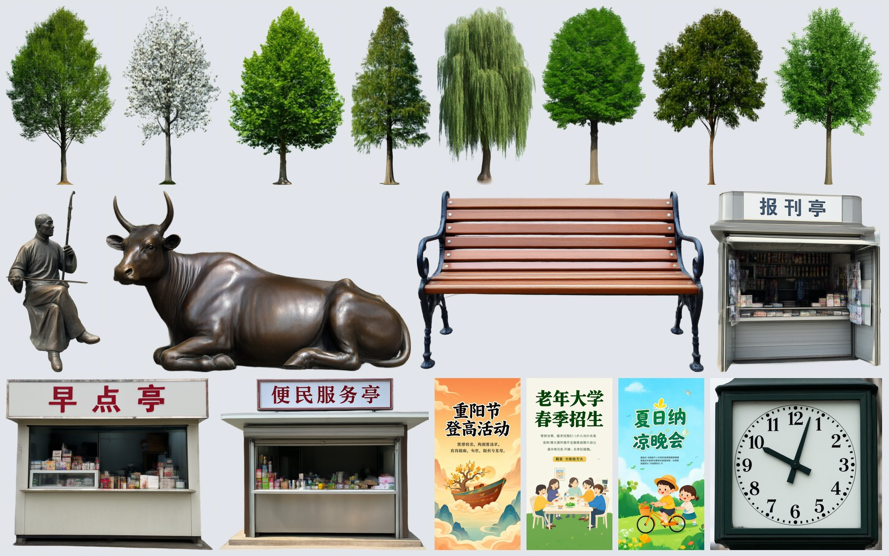
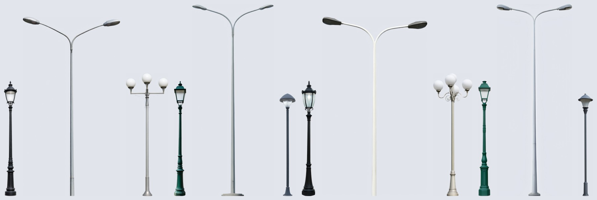
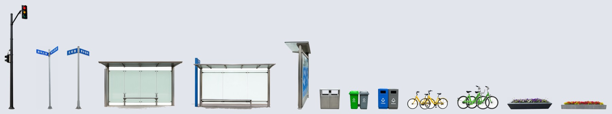
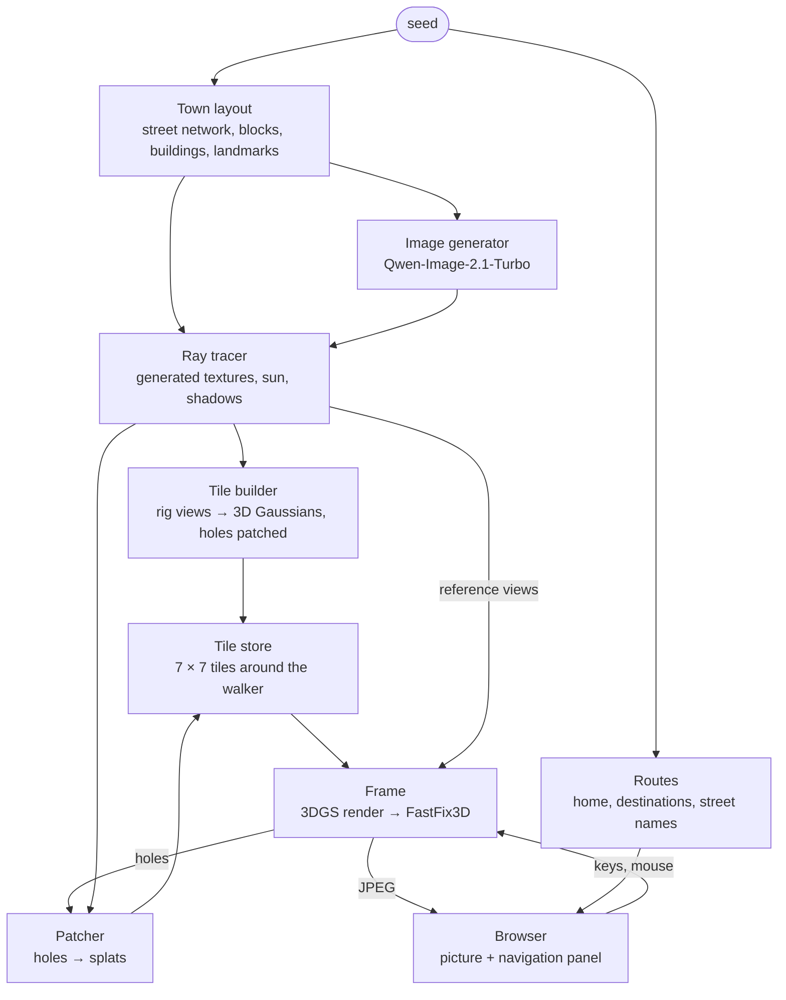

# 3dgen: generated street worlds for route training

**Walk from home to the clinic, the market or the senior centre through an endless street town that is generated as you walk, with a navigation panel that names a landmark at every turn and every frame repaired live by FastFix3D. The worlds are built for route practice by older adults with mild cognitive impairment (MCI) or early Alzheimer's disease, and need no hand-built scenes.**

- **Route training:** every walk starts at home, a residential compound with its name plate, and leads to one of four everyday destinations: a community health centre, a market, a senior centre or a post office. Every turn is at a crossing with a landmark.
- **Navigation panel:** turn-by-turn instructions in Chinese that name the landmark and the street (在彩票站路口右转，进入光明路: turn right at the lottery kiosk, into Guangming Road), a heading-up map with the route, the landmarks, home and the destination, remaining distance and walking time, and a warning when the walker leaves the route.
- **A town worth looking at:** avenues, streets and lanes on an irregular grid with T-junctions; shop buildings with podiums, set-back towers, forecourts and roof structures; residential compounds with walls and a gate, schools, squares, market halls and parks; bus shelters, traffic lights, street-name signs, bins, shared bikes and planters along the streets.
- **Generated while you walk:** 96.2 % of the non-sky picture is generated by Qwen-Image-2.1-Turbo the first time it comes into view: every building's facade (most with a shop and its Chinese sign), every street's asphalt, every block's paving and ground, and every tree, lamp and piece of street furniture.
- **The same place every time:** the town is a pure function of a seed, and every generated image is cached by its key, so a street walked again looks exactly as before and a route can be practised day after day.
- **Real time:** 3DGS render and FastFix3D at 22–24 fps at 960×540 on one RTX PRO 6000.

*One frame of a walk through the generated town, repaired live by FastFix3D (960×540).*

*Street trees, statues, a bench, kiosks, community posters and a street clock, generated during walks.*

*Street lamps generated during walks, drawn to scale: one design per street segment, two examples of each of the six designs.*

*Traffic lights, street-name signs, bus shelters and a shelter side panel, bins, shared bikes and planters, generated during walks, drawn to scale.*

## Built for route practice

Older adults with MCI or early Alzheimer's disease often still recognise landmarks but cannot tie them to places and turns (deIpolyi et al. 2007), and practice in a detailed virtual town carries over to the real one (Wallet et al. 2011). The worlds follow from this.

- **A landmark at every decision point:** the brain stores what stands at a crossing without effort (Janzen & van Turennout 2004), and salient cues at decision points helped people with AD and MCI find their way (Davis et al. 2017). About half of the crossings carry a landmark, every turn of a route is at one, and the route planner prefers a different landmark for each turn.
- **Streets that can be told apart:** each street has its own name, and the name carries its class (大道 / 路 / 巷 in one direction, 大街 / 街 / 胡同 in the other); a street-name sign at every crossing names both streets, and bus shelters carry the street's name. Each stretch between two crossings has its own tree species and street lamp design, and most buildings a shop with its own Chinese sign.
- **Repeatable routes:** the routes are fixed by the seed, so the same route can be walked again with the same landmarks in the same places.
- **No invented content:** people with memory problems learn their own errors (Baddeley & Wilson 1994). The ray-traced town is the ground truth for every frame, FastFix3D keeps the 3D render and adds only a correction, and the ground truth view is available live for checking.
- **Smooth pictures:** delay and flicker cause cybersickness (LaViola 2000); every frame is repaired and streamed in real time.
- **No hand-built scenes:** layout, appearance and routes are generated, and a new seed gives a new town with new routes.

## Walkthrough architecture

The town is never stored. Every part of it is computed from the seed when the walker comes near, reconstructed into 3D Gaussians tile by tile, and rendered and repaired frame by frame on the server; the browser shows the pictures and the navigation panel.

- **Town from a seed:** street lines about 44 m apart, each shifted up to 7 m from its regular place, so blocks are 30–58 m across. Every fourth line is a four-lane avenue and about a third of the others are lanes; some street segments are left out, which makes T-junctions, and every crossing keeps at least three arms. A block is a row of street-front buildings on each side that faces a street (a shop podium with a set-back tower, a forecourt, a passage between two buildings, a stair housing or a water tank on the roof; taller on avenues and corners, lower on lanes), a residential compound, a school, a square, a market hall or a park. Every block is generated from its own hash, together with the street furniture of its two street segments and the landmark, traffic lights and street-name sign of its crossing, so any part of the town can be built on its own and a place walked back to is unchanged. The routes and the street names come from the same seed.
- **Looks generated on demand:** every object has a key, computed from the seed and its geometry, and a prompt. The walk server asks the generator service for what the next tiles and the walker's surroundings need, nearest first; the service writes each image once, and every later visit reads it from the cache. A tile waits for its images before it is built, so its reconstruction carries the generated looks.
- **Ground truth by ray tracing:** a GPU ray tracer (Triton) renders the town with the generated textures, alpha-tested cut-outs for trees, street lamps and street furniture, sun and shadows. It renders the views the tiles are built from, the reference views for FastFix3D and the ground-truth view.
- **Tiles built like a filmed walk:** the town is reconstructed in 20 m tiles on a fixed lattice; a tile is built where a street corridor crosses it, and the squares inside the blocks belong to the nearest built tile. For each tile the ray tracer renders eye-level views on the crossings and street segments that reach into it (level rings, views tilted up at the facades, and context views further along the streets; 45 views for a typical tile), the way a walking video sees a street. The views become 3D Gaussians either directly, as one surface-aligned disc per pixel and one splat per 2.5 cm voxel from the closest view, or through WorldMirror, with the model's positions scaled per view to metres on the true depth. Splats outside the tile or off every real surface are removed.
- **Holes closed twice:** after a tile is built it is rendered from walker-like probe views at its street points; uncovered pixels whose ray hits a surface of the tile get surface-aligned discs from the ray tracer. While walking, holes a frame shows (uncovered pixels with cover above them, so not the sky) go to a background thread that traces them once and adds what the rays hit as splats; a hole closes a frame or two after it first shows and costs nothing afterwards.
- **Streaming around the walker:** the tiles of a 7 × 7 square around the walker are built nearest first on the build GPUs, cached on disk and moved to the walk GPU; tiles that fall out of reach are dropped. Each frame draws only the tiles in the field of view, at three levels of detail (the full tile, then 6 cm and 15 cm voxels from 8 m and 25 m).
- **Repair every frame:** the walk GPU splats the tiles at the walker's pose, adds sky and haze, and FastFix3D repairs the frame against the tile view closest to the walker's pose. The frame goes to the browser as JPEG over a WebSocket, and the browser sends keys and mouse movement back.
- **Navigation in the browser:** the page loads the routes once and the block outlines around the walker as it moves, and draws the instruction card and the heading-up map from the walker's position and heading in every frame.

## Results

### Generated content

Share of non-sky pixels over 36 eye-level views on the streets around the start (960×540):

| Content | Share | Made by |
|---|---|---|
| Street-front buildings with shop signs | 54.2 % | Qwen-Image-2.1-Turbo |
| Compounds, schools, market halls, walls | 0.4 % | Qwen-Image-2.1-Turbo |
| Roof housings and water tanks | 0.1 % | Qwen-Image-2.1-Turbo |
| Road, sidewalk and block grounds | 28.6 % | Qwen-Image-2.1-Turbo |
| Trees | 9.7 % | Qwen-Image-2.1-Turbo |
| Street lamps | 0.8 % | Qwen-Image-2.1-Turbo |
| Bus shelters, traffic lights, street-name signs, bins, bikes, planters, benches, statues | 2.1 % | Qwen-Image-2.1-Turbo |
| Kiosks, poster columns, street clocks | 0.2 % | Qwen-Image-2.1-Turbo |
| Road markings and kerbs | 2.8 % | code (aligned with the street geometry) |
| Objects whose image is being generated | 1.1 % | code, replaced when the image is ready |

### Speed

| Step | GPU | Time |
|---|---|---|
| Walk frame: 3DGS render, FastFix3D, JPEG stream | RTX PRO 6000 | 22–24 fps at 960×540 |
| One generated image (FP8, 8 steps) | RTX PRO 4000 | 3.8 s |
| One tile: views, splats, hole patching | RTX PRO 5000 | 5–10 s |
| Start-up: the 42 tiles around home, their images already generated | RTX PRO 6000 + RTX PRO 5000 | about 5 min |

### Coverage

Surface pixels left uncovered while walking: 0.04 % per frame (mean over a 78 m walk at walking pace from home).

## Repository

| Path | Contents |
|---|---|
| `endless-streets/` | the street town: world, routes, image generator service, ray tracer, tile builder, walk server, page |
| `endless-labyrinth/` | the predecessor: an infinite maze reconstructed on demand by WorldMirror and rendered in WebGL2; its tile helpers are used by the street town |
| `docs/` | usage and figures |
| `sync.sh` | pulls the working copies of both projects into this repository |

How to run each step: [docs/USAGE.md](docs/USAGE.md).

## References

- Baddeley, A., & Wilson, B. A. (1994). When implicit learning fails: Amnesia and the problem of error elimination. *Neuropsychologia*.
- Davis, R., Ohman, J. M., & Weisbeck, C. (2017). Salient cues and wayfinding in Alzheimer's disease within a virtual senior residence. *Environment and Behavior*.
- deIpolyi, A. R., Rankin, K. P., Mucke, L., Miller, B. L., & Gorno-Tempini, M. L. (2007). Spatial cognition and the human navigation network in AD and MCI. *Neurology*.
- Janzen, G., & van Turennout, M. (2004). Selective neural representation of objects relevant for navigation. *Nature Neuroscience*.
- LaViola, J. J. (2000). A discussion of cybersickness in virtual environments. *ACM SIGCHI Bulletin*.
- Wallet, G., Sauzéon, H., Pala, P. A., Larrue, F., Zheng, X., & N'Kaoua, B. (2011). Virtual/real transfer of spatial knowledge: Benefit from visual fidelity provided in a virtual environment. *Cyberpsychology, Behavior, and Social Networking*.
